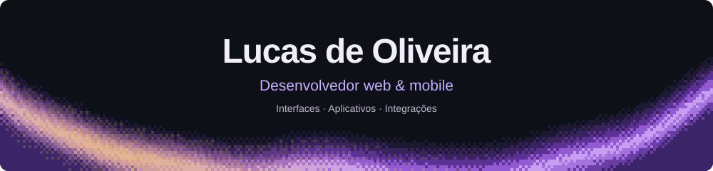
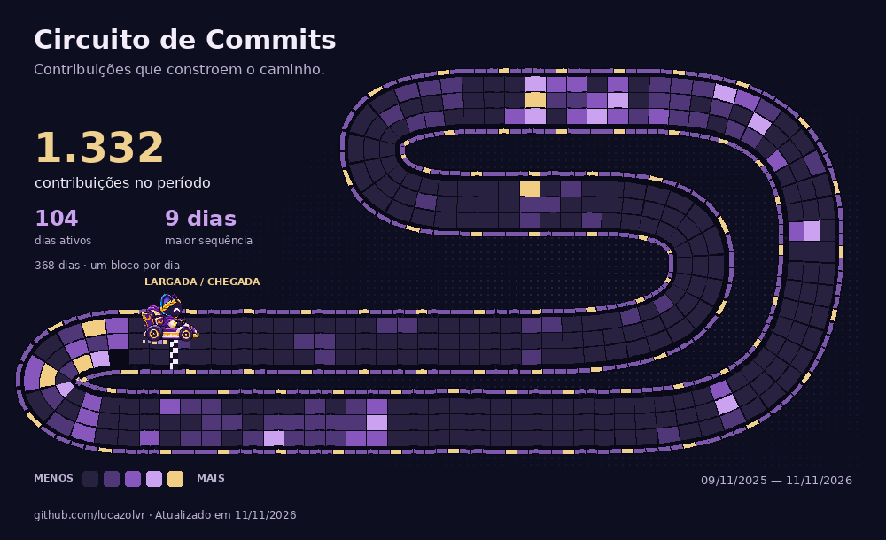

  

  
  
  
  

Construo interfaces, aplicativos e integrações com atenção à experiência de quem usa.

## Tecnologias

<strong>Web &amp; mobile</strong>

  

<strong>APIs, dados &amp; ferramentas</strong>

  

## Circuito de Commits

  

  
Sobre a pista · versão sem animação

  
Cada bloco representa um dia real do calendário do GitHub, incluindo as contribuições privadas anonimizadas visíveis no perfil. O período e a data da atualização estão na imagem.

  

 

O importante é o que se faz, não o que se diz.

