  

  
  
  
  

  
Tecnologias em texto e pista sem animação

  
Construo interfaces, aplicativos e integrações com atenção à experiência de quem usa.

  
<strong>Linguagens</strong> — TypeScript, JavaScript, Python, Java, HTML e CSS.

  
<strong>Frontend, UI e mobile</strong> — React e React Native, Next.js, Tailwind CSS, Vite, Three.js e Flutter.

  
<strong>Backend e APIs</strong> — Node.js, Fastify, Spring Boot, Django, NestJS, Postman e GitHub.

  
<strong>Dados e cache</strong> — PostgreSQL, MySQL, Redis e Prisma.

  
Cada bloco da pista representa um dia real do calendário de contribuições do GitHub, incluindo as contribuições privadas anonimizadas visíveis no perfil. Roxo, lilás e dourado indicam a intensidade de cada dia. O período e a data da atualização estão na imagem.

  
  
<a href="https://github.com/lucazolvr?tab=overview">Ver atividade no GitHub</a>

  
<em>O importante é o que se faz, não o que se diz.</em>

