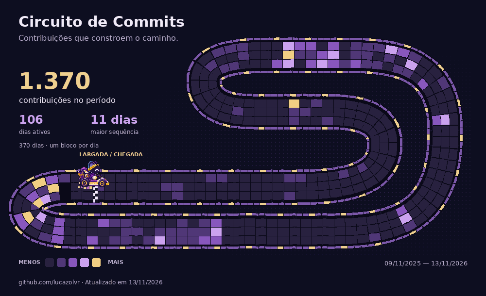

  <a href="https://lucazolvr.tech">Portfólio</a> &nbsp;·&nbsp;
  <a href="https://www.linkedin.com/in/lucazolvr/">LinkedIn</a> &nbsp;·&nbsp;
  <a href="mailto:lucazolvr@gmail.com">E-mail</a> &nbsp;·&nbsp;
  <a href="https://www.instagram.com/lucazolvr/">Instagram</a>

Sou **Lucas de Oliveira, desenvolvedor web e mobile**. Construo aplicações que conectam interface, dados e a rotina de quem usa — de registros no campo a mapas, cuidado com animais e gestão de operações.

Antes do código, entender o problema. Depois, fazer cada parte funcionar junto.

### Ideias que já ganharam forma

| Projeto | O que estou construindo |
| :--- | :--- |
| **[ReproBov](https://lucazolvr.tech/projetos/reprobov/)** | Gestão reprodutiva de bovinos, com registros em campo, indicadores do rebanho e operação offline. |
| **[ObservaPet](https://observapet.com.br/)** | Registro e acompanhamento de animais em situação de rua, com mapas e apoio a ONGs parceiras. |
| **[The Places](https://lucazolvr.tech/projetos/the-places/)** | Informações sobre o movimento dos lugares de Teresina, para decidir antes de sair. Em construção. |
| **[Chips](https://chipsgestao.com.br/)** | Clareza sobre gastos e perdas, ajudando apostadores a reconhecer padrões e repensar sua relação com as apostas. |
| **[Sigma Painel](https://lucazolvr.tech/projetos/sigma-painel/)** | Gestão de assinantes, cobranças e caixa, com atendimento integrado ao Telegram. Sistema privado; prévia com dados fictícios no portfólio. |

### Da interface à aplicação

**Web** &nbsp; Next.js · React · TypeScript · Tailwind CSS 
**Mobile** &nbsp; React Native · Expo · Flutter 
**APIs e dados** &nbsp; Node.js · NestJS · Python · Supabase 
**Integrações** &nbsp; MapLibre · Telegram · GitHub

### Circuito de Commits

Cada bloco da pista representa **um dia**. A cor mostra a intensidade das contribuições, do roxo ao dourado. Os dias seguem em ordem cronológica, três por trecho, ao longo do traçado.

Contribuições públicas e privadas anonimizadas, conforme exibidas no calendário público do GitHub. A imagem é atualizada diariamente pelo workflow deste repositório.

  
Ver a pista sem animação

   
  

---

**Sua próxima ideia começa numa conversa.** 
[Vamos construir algo juntos →](mailto:lucazolvr@gmail.com)

“O importante é o que se faz, não o que se diz.”
